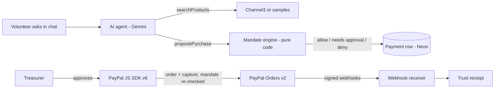

# Quartermaster

**An AI purchasing agent for volunteer teams that buys and reimburses with PayPal — but only inside spending mandates a human signed, enforced in code.**

Built for the [PayPal AI Hackathon](https://paypalaihackathon.devpost.com/) (Oct–Nov 2026).

> Volunteer groups — cleanup crews, school PTAs, food banks, sports clubs — run on people fronting their own money and waiting weeks to be repaid, while treasurers can't prove each purchase followed the rules. Quartermaster lets a member ask for what an event needs in plain English. The agent finds options, a deterministic **mandate engine** decides whether the purchase is allowed, needs the treasurer, or is blocked, and PayPal moves the money only after that check. Every payment gets a **trust receipt** showing what was asked, what was compared, which rule allowed it, and the PayPal IDs.

## How it works



**The key design rule: the AI never moves money.** It can search, read the policy and *propose*. The mandate engine (`src/lib/mandates/engine.ts`) decides using fixed rules — cap, expiry, categories, vendors, per-item and per-order auto limits, and split-purchase detection — and the mandate is checked again right before the PayPal order is created and captured. Prices come from the stored search results, never from the model.

## Try it

**Hosted demo:** _add your Render URL here_

1. Click **Try as a volunteer** and send a suggested request.
2. Open the proposal's approval page → **Switch to treasurer** → **Approve & pay** with a sandbox PayPal buyer account (credentials below).
3. Open the **trust receipt** to see the rules applied, the options compared and the PayPal IDs.

Sandbox buyer login: _add a sandbox personal account email + password here_

## Run it locally (about 10 minutes, all free)

Prerequisites: Node 20.11+ and accounts on PayPal Developer, Neon and Google AI Studio.

```bash
git clone <this repo> && cd quartermaster
npm install
cp .env.example .env.local   # fill in the values — each line says where to get it
npm run check:env            # tells you exactly which value is missing or wrong
npm run setup                # checks env, creates tables in Neon, seeds the demo org
npm run dev                  # http://localhost:3000
```

**Getting the Neon connection strings:** in the [Neon console](https://console.neon.tech), open your project and click **Connect**. Copy the string with **Connection pooling** on into `DATABASE_URL` (its host contains `-pooler`). Turn pooling off and copy again into `DATABASE_URL_DIRECT`. Both end in `?sslmode=require`.

| Variable | Where to get it (free) |
|---|---|
| `DATABASE_URL`, `DATABASE_URL_DIRECT` | [Neon](https://console.neon.tech) → project → Connection details (pooled and direct) |
| `PAYPAL_CLIENT_ID`, `PAYPAL_CLIENT_SECRET` | [PayPal Developer](https://developer.paypal.com/dashboard/) → Apps & Credentials → Sandbox |
| `PAYPAL_WEBHOOK_ID` | Same app → Webhooks → add `https://<your-url>/api/webhooks/paypal` (locally via `cloudflared tunnel --url http://localhost:3000`) |
| `SANDBOX_PAYEE_EMAIL` | A sandbox **business** account that stands in for retailers |
| `SANDBOX_VOLUNTEER_EMAIL` | A sandbox **personal** account that receives reimbursements |
| `GOOGLE_GENERATIVE_AI_API_KEY` | [Google AI Studio](https://aistudio.google.com/apikey) |
| `CHANNEL3_API_KEY` | [Channel3](https://trychannel3.com/developers) (hackathon promo code on the Devpost sponsor page). Optional: without it, labelled sample products are used |

Webhook events to subscribe to: `PAYMENT.CAPTURE.COMPLETED`, `PAYMENT.CAPTURE.DENIED`, `PAYMENT.CAPTURE.REFUNDED`, `CHECKOUT.ORDER.APPROVED`, and for reimbursements `PAYMENT.PAYOUTS-ITEM.SUCCEEDED`, `PAYMENT.PAYOUTS-ITEM.FAILED`, `PAYMENT.PAYOUTS-ITEM.UNCLAIMED`, `PAYMENT.PAYOUTSBATCH.SUCCESS`.

PayPal sandbox notes: create the Merchant app on a **US** sandbox business account, pay with a **US** sandbox personal account (not the business one), and tick **Payouts** under the app's Features. If `cloudflared` can't connect (QUIC/UDP blocked), run `cloudflared tunnel --protocol http2 --url http://localhost:3000`.

```bash
npm test          # mandate engine unit tests
npm run typecheck
```

## Use it from another AI agent (MCP)

Quartermaster is also an MCP server at `/api/mcp` (streamable HTTP). Outside agents can list mandates, search products, dry-run (`check_purchase`), **request** purchases (`request_purchase`), search the policy, read trust receipts and submit receipts. They can never pay: every request goes through the same mandate engine, and its trust receipt names the agent.

1. Switch to the treasurer and open **Agents** (`/settings`). Create a key. It's shown once.
2. **Claude Desktop:** Settings → Developer → Edit config, paste the snippet the page shows into `claude_desktop_config.json`, and restart Claude. It looks like this:
   ```json
   {
     "mcpServers": {
       "quartermaster": {
         "command": "npx",
         "args": ["-y", "mcp-remote@0.14.3", "http://localhost:3000/api/mcp", "--header", "Authorization: Bearer qm_live_..."]
       }
     }
   }
   ```
3. Try: *"Use Quartermaster to buy 4 folding tables for the beach cleanup."* With the demo data the Beach mandate is nearly spent, so the request is **blocked under rule M7**. It still appears on the treasurer's Dashboard and gets a trust receipt marked "Asked by: External agent (…)".

To test without Claude Desktop:

```bash
npx -y @modelcontextprotocol/inspector@2.10.1 --cli http://localhost:3000/api/mcp --transport http \
  --header "Authorization: Bearer qm_live_..." --method tools/list
```

## API, Postman and SDK

Every public route is described in an OpenAPI 3.1 document served at **`/api/openapi.json`**. Request bodies in it come from the same zod schemas the routes validate with, and a test fails if a route is missing, so it can't drift.

**Postman.** `postman/` holds a collection (39 requests, 82 assertions) and a sandbox environment, both generated from the OpenAPI document by `npm run postman:build`. The collection signs in as the demo volunteer and treasurer and checks that signed-out calls, bad input and the wrong role are refused. It never moves money.

<!-- TODO after publishing the collection to your public Postman workspace: replace COLLECTION_ID and remove this comment.
[](https://app.getpostman.com/run-collection/COLLECTION_ID)
-->
- Import `postman/quartermaster.postman_collection.json` and `postman/quartermaster-sandbox.postman_environment.json` into Postman, pick the **Quartermaster sandbox** environment, set `baseUrl`, and run the collection. Or import `https://<your-app>/api/openapi.json` to get one request per route.
- From the command line, against a production build with PayPal mocked: `npm run test:e2e -- --build-only`, then `npm run test:api` (see [Tests](#tests)).

**TypeScript SDK.** [`sdk/`](sdk/) is a dependency-free client with one method per route and a README example:

```ts
import { QuartermasterClient } from "./sdk/src/index";

const qm = new QuartermasterClient({ baseUrl: "http://localhost:3000" });
await qm.signIn("treasurer");
const { key } = await qm.createApiKey("my agent");
const tools = await qm.mcp(key, "tools/list"); // the same seven tools the MCP server offers
```

I used the **APIMatic PayPal context plugin** while writing the PayPal calls (`src/lib/paypal/client.ts`). The SDK in `sdk/` is written by hand from the same OpenAPI document, so it works today; to produce APIMatic's own SDK and docs portal, import `/api/openapi.json` at [apimatic.io](https://www.apimatic.io) and follow [sdk/README.md](sdk/README.md).

## Tests

| Command | What it runs |
|---|---|
| `npm test` | 128 unit tests: mandate engine, receipts, search, approvals, OpenAPI coverage, SDK coverage |
| `npm run typecheck`, `npm run build` | Types and the production build |
| `npm run test:api` | The Postman collection with newman, against a built app and a mock PayPal (`scripts/mock-paypal.mjs`) |
| `npm run test:e2e` | Playwright: home, volunteer chat, proposal, treasurer approves and pays, trust receipt; plus every page at 360 px width |

`test:api` and `test:e2e` build the app with `AI_MOCK=true` (a scripted stand-in for Gemini, listed on `/status` as a fallback) and `PAYPAL_API_BASE` pointing at the mock, so they need no PayPal or Gemini keys. They create and pay a mock purchase, so give them their own Neon branch: set `E2E_DATABASE_URL` (or `E2E_USE_DEV_DB=1` to accept a mock payment in your dev database). CI runs them when the repository secret `CI_DATABASE_URL` is set.

## Deploy

[](https://render.com/deploy) — uses `render.yaml` (one web service). Set the environment variables, then run `npm run setup` once locally against the same Neon database.

## What's built so far

- [x] Mandate engine with 30+ unit tests (allow / needs approval / deny, split-purchase detection, cap including committed spend)
- [x] Agent chat (Gemini via Vercel AI SDK) with tools: list mandates, read policy, search products, propose purchase
- [x] Channel3 product search with caching and an offline sample fallback
- [x] PayPal Orders v2 + JS SDK v6 approval flow; mandate re-checked before order creation and capture; idempotency keys
- [x] Signature-verified PayPal webhooks, stored by event id (idempotent)
- [x] Trust receipts with options compared, rules applied, PayPal IDs and a timeline
- [x] Treasurer view of mandates, budgets and pending approvals; `/status` page for integrations
- [x] Snap-to-reimburse: Gemini reads the receipt photo, duplicate and receipt checks, mandate engine, treasurer approval, PayPal Payouts, confirmed by webhook or polling
- [ ] Policy search (pgvector → Elastic), KERNEL live price verification, Zapier approvals
- [x] MCP server, OpenAPI 3.1, Postman collection with newman, TypeScript SDK, Playwright smoke test
- [ ] AG Studio treasurer dashboard, Elastic, Bryntum

## Tech and tools

| Tool | How it's used |
|---|---|
| PayPal Orders v2, JS SDK v6, webhooks (sandbox) | All payments, approval checkout, payment events |
| Google Gemini (Flash) via Vercel AI SDK | Agent reasoning and tool calling |
| Channel3 | Product search across retailers |
| Neon Postgres + Drizzle ORM | Data, audit trail, cache |
| Next.js, Tailwind | App and API |
| Postman, newman | Collection generated from the OpenAPI document, run in CI |
| APIMatic | PayPal context plugin used while coding; SDK and docs portal from the OpenAPI document |
| Playwright | Browser smoke test with PayPal mocked |
| Render | Hosting |

## License

MIT — see [LICENSE](LICENSE).
