# flow.md — how much of the workflow is done, and what's left

Updated every time something is built or changed. The reasons behind each choice are in [decision.md](decision.md).

**Last updated:** Oct 24, 2026 · **Build plan position:** Days 1–6 and 8 verified; Days 15–16 (Task 8) built, newman verified, Playwright smoke test written but not run (needs a Neon branch); manual checklist in TESTING.md · **Next:** see “What to do next” at the bottom

### Status key
| Mark | Meaning |
|---|---|
| ✅ | Done and verified (ran successfully) |
| 🟡 | Code written, not yet run (needs `npm install` and keys on your machine) |
| ⬜ | Not started |
| ➖ | Optional or cut if behind schedule |

### At a glance
| Area | ✅ | 🟡 | ⬜ |
|---|---|---|---|
| Hero flow A: agent purchase | 10 | 0 | 3 |
| Flow B: snap-to-reimburse | 6 | 0 | 0 |
| Flow C: money in (dues, invoices) | 0 | 0 | 3 |
| Flow D: refunds and exceptions | 1 | 0 | 1 (+2 optional) |
| Flow E: treasurer dashboard | 0 | 1 | 3 |
| Flow F: external agents (MCP) | 0 | 0 | 3 |
| Submission requirements | 0 | 3 | 6 |

Honest summary: the whole money path is proven with real sandbox money. Agent → mandate engine → treasurer approval → PayPal capture → signed webhook → trust receipt all work, and so do refunds (webhook marks the order refunded and the budget gets the money back) and PayPal Payouts (a $1 test payout reached the personal account). Fake webhooks are rejected. What's left is building Flows B, C, E and F, deploying, and the submission items.

### Repo move (Oct 23): app at the repo root
| Step | Result |
|---|---|
| App moved from `quartermaster/` to the repo root (`git mv`, history kept) | ✅ 118 tracked files moved; `.env.local` still ignored |
| Stray copies | ✅ leftover build output and a dev-server `layout.js` stub deleted after your OK; old dev server stopped |
| CI from the root | 🟡 workflow updated (no `working-directory`); runs on the next push |
| Render from the root | 🟡 `render.yaml` needs no change; not deployed |
| `CLAUDE.md` with the working rules | ✅ added |
| `TESTING.md`: manual checklist for the 9 features no person has used yet, plus the demo reset | ✅ written · 🟡 checks not run yet: that's your list |
| Found along the way | After `npm run db:seed` the Beach mandate has $438 left, so the README's "4 folding tables → blocked under M7" only holds on today's test data. TESTING.md uses 12 tables. Fix the README before recording · `/treasurer` has no role guard (volunteers get a read-only view) |

### Days 15–16 (Oct 24): API docs, Postman, SDK, tests and polish (Task 8)
| Step | Result |
|---|---|
| OpenAPI 3.1 at `/api/openapi.json` | ✅ 21 paths, every `route.ts` covered (test), bodies from the shared zod schemas, 3.1 dialect (D53) |
| Unit tests | ✅ 128/128 (new: OpenAPI coverage 5, SDK coverage 2, scripted model 3) |
| Postman collection + environment (`npm run postman:build`) | ✅ 39 requests, 82 assertions |
| Newman against a **production build** with a mock PayPal (`npm run test:api`) | ✅ 82/82 passed (Oct 24) |
| Routes' 401 now JSON | ✅ chat page reads it |
| Mock PayPal (`scripts/mock-paypal.mjs`) and scripted agent (`AI_MOCK=true`, shown on /status) | ✅ both exercised through newman · 🟡 the scripted agent's chat path is only exercised by the smoke test |
| Playwright: 8 pages at 360 px + keyboard focus | ✅ 9/9 against `next dev` (read-only, dev DB) after the nav fix |
| Playwright hero-flow smoke test (home → chat → proposal → treasurer pays → receipt) | 🟡 written, **not run**: it pays a mock purchase, so it needs its own Neon branch (TESTING.md 10.1) |
| CI job `api-and-browser` (build, newman, re-seed, Playwright) | 🟡 written; runs once the secret `CI_DATABASE_URL` exists |
| TypeScript SDK in `sdk/` with README example | ✅ hand-written, covered by a test · 🟡 APIMatic's own SDK and portal need your account (D55) |
| README: Postman, SDK and Tests sections; tools table | ✅ · 🟡 "Run in Postman" button is a commented placeholder until you publish the collection |
| Polish pass: nav wrap, contrast, labels, loading / empty / 404 states (D56) | ✅ measured where possible · 🟡 no screen-reader pass, no manual look at every page at 360 px |
| Side effect | The newman run on your dev database created and revoked one API key and its "External agent (newman)" member (twice). Harmless; `npm run db:seed` clears them |

### Day 14 (Oct 23): Quartermaster as an MCP server
| Step | Result |
|---|---|
| No key | ✅ 401 with a plain message |
| MCP Inspector 2.10.1 `tools/list` | ✅ 7 tools |
| Inspector: list_mandates → search_products → check_purchase → request_purchase | ✅ 4 folding tables, $179.88, on the Beach mandate with $0.83 left → **blocked under M7** (and M10 split-purchase flag) |
| The blocked attempt | ✅ trust receipt "Asked by: External agent (Claude Desktop (test))", listed on /treasurer |
| `/settings` keys page | ✅ renders · key created once, hash stored |
| Claude Desktop | 🟡 config snippet on /settings and in the README; you need to paste it into Claude Desktop |

### Day 13 (Oct 23): money in and refunds
| Step | Result |
|---|---|
| `npm run setup:dues` | ✅ sandbox product `PROD-78E8055513737793A`, plan `P-8DS098128A9567949NLNXAWY` ($10/month), Operations budget created |
| `/join` | ✅ PayPal Subscribe and card buttons render (checked in Chrome) · 🟡 subscribing needs your sandbox personal login |
| Agent: "invoice our sponsor Marina Cafe $250" | ✅ called createSponsorInvoice → PayPal **draft**; reply shares the review link and doesn't claim it was sent |
| Send the invoice | ✅ volunteer refused · ✅ treasurer sent it (PayPal SENT, sponsor view link) · 🟡 paying it needs a sandbox payer |
| Refund button | ✅ shown to the treasurer only on paid receipts · ✅ volunteer refused · ✅ unpaid order refused · 🟡 not clicked on your one paid order (refunds were verified through the API on Oct 20) |
| Credits and ledger maths | ✅ 10 unit tests: sale, transaction, invoice credits, one credit per PayPal id, dues + sponsorship raise the cap, refund returns money |

### Day 12 (Oct 23): treasurer dashboard on AG Grid Community
| Step | Result |
|---|---|
| `/treasurer` renders with live data | ✅ checked in Chrome: queue (1), 2 envelopes (Beach 99.9% used, $0.83 left), 3 charts, 18 payments, 7 reimbursements |
| Phone width (400 px) | ✅ no page overflow; grids scroll inside their frames |
| Ledger maths | ✅ 6 unit tests (spent/committed, refunds excluded, zero-filled days) |
| Approve from the grid | ✅ clicked in Chrome as the treasurer (signed link sign-in): $42.17 payout `Q8L8SDP74Y4M2` → paid |

### Days 10–11 (Oct 23): KERNEL live checks and approval notices
| Step | Result |
|---|---|
| `comparePrice`, age labels, URL guard | ✅ 8 unit tests |
| Signed approval links (HMAC, 72 h) | ✅ 6 unit tests · ✅ live: link signs the treasurer in and opens /approve/<id>; an edited link lands on /mandates?link=bad_signature |
| Notifier with no channel configured | ✅ records "waits on the treasurer's Mandates page" in the audit trail |
| KERNEL verification, screenshot on the receipt | 🟡 written; needs `KERNEL_API_KEY` (sponsor credits) |
| Zapier MCP → Slack/email | 🟡 written; needs your Zapier MCP server URL |
| Slack incoming webhook, Resend email fallbacks | 🟡 written; need `SLACK_WEBHOOK_URL` / `RESEND_API_KEY` |

### Day 9 (Oct 23): policy and history search with pgvector
| Step | Result |
|---|---|
| pgvector on Neon | ✅ 0.8.6 enabled (`npm run db:vector`) |
| Tables `policy_chunks`, `search_index` + HNSW indexes | ✅ created with `npm run db:migrate` (D46: `drizzle-kit push` is unsafe on Postgres 18) |
| `npm run db:index` | ✅ 13 policy clauses and 23 purchases/receipts embedded (gemini-embedding-2, 768 dims) |
| searchPolicy | ✅ "two quotes" → 3.2, 3.3 · "deliveries" → 4.1 · "beer" → 2.3 · "how long for my receipt" → 5.1 |
| purchaseHistory | ✅ "garbage bags" finds the Uline "Heavy-duty trash bags (100)" |
| Agent: "Do we need two quotes for a $300 order of tables?" | ✅ called searchPolicy, answered "According to Policy 3.3…" and 3.2 |
| Duplicate by meaning | ✅ a re-shot Walmart receipt matches the original at 0.957 (next best 0.725) → R3 warning with a link · ✅ 15 unit tests for chunking, keyword fallback and the threshold |
| Not tried yet | A full chat purchase with the new parallel step (search products + policy + history); watch that it still fits in 8 steps |

### Eighth run (Oct 23): snap-to-reimburse verified end to end
| Step | Result |
|---|---|
| `npm test`, `npm run typecheck`, `npm run build` | ✅ 70/70 tests (engine 34, units 16, receipts 20), types clean, build clean |
| Database columns for reimbursements | ✅ already pushed to Neon |
| `npm run spike:payout` ($1 to the personal sandbox account) | ✅ batch PENDING → SUCCESS in about 20 s |
| Home Depot receipt, $42.17, Beach Cleanup mandate | ✅ Gemini read every line, tax, date and domain; R1–R5 passed · ✅ **blocked under M7**: the mandate has only $0.83 left after earlier tests |
| Walmart receipt, $27.81, Winter Food Drive mandate | ✅ read in 22 s → needs treasurer → approved → payout `9G526YC9UN5D8` → **paid** about 22 s after approval |
| Same Walmart photo again | ✅ rejected: "R3: The same photo was already submitted", linked to the first one |
| `/reimbursements/[id]` and `/mandates` | ✅ load (200) |
| Found along the way | Running `next build` while `npm run dev` runs breaks the dev server (D43): use `NEXT_DIST_DIR=.next-check npm run build` · CI never ran because the workflow sat in the app folder (D42, fixed) |
| Still to try | A photo from your phone through the tunnel (camera capture and in-browser shrinking) |

### Build 2026-10-20.1: snap-to-reimburse and fixes
| Area | Status |
|---|---|
| `/reimburse`: photo upload (opens the phone camera), shrinks the photo in the browser, pick the budget, optional note | 🟡 |
| Gemini vision reads store, date, items, tax and total (AI SDK v6 `generateText` + `Output.object`) | 🟡 |
| If Gemini can't read it (quota, blurry photo): type the details in by hand, flagged for the treasurer | 🟡 |
| Receipt checks R1–R5: readable, within 30 days, not a duplicate, items add up, PayPal email on file | ✅ 20 unit tests pass here |
| Duplicate check: same photo (SHA-256) or same store + date + total → rejected; same date + total → warning | ✅ in the tests |
| Receipt turned into a mandate proposal (tax line, discounts), judged by the same engine M0–M10 | ✅ in the tests |
| Budgets now count reimbursements too (paid = spent, payout sent = committed) | 🟡 `loadLedger` |
| `/reimbursements/[id]`: photo next to what was read, checks, rules, budget bar, timeline, approve / reject | 🟡 |
| Approve → mandate re-checked → PayPal Payout; double clicks can't pay twice | 🟡 |
| Payout confirmed by webhook (`PAYMENT.PAYOUTS-ITEM.*`) or by the page asking PayPal every 3 s; shows "paid N seconds after the photo" | 🟡 |
| Mandates page: reimbursements waiting for you + recent reimbursements; "Reimburse" in the navigation | 🟡 |
| Fixes: "Signing in…" button, `check:env` now requires PayPal and Gemini keys, `units.test.ts` (16 cases), tunnel warning (`allowedDevOrigins`) | ✅ tests · 🟡 rest |
| Checked here | ✅ 34 + 16 + 20 tests · ✅ syntax of all 27 changed files · ✅ types between the new modules (libraries stubbed: the package registry is blocked here, so run `npm run typecheck` and `npm run build` on your machine) |

### Seventh run (Oct 20): webhook, refund and payout verified
| Step | Result |
|---|---|
| Agent on "200 bottles and 20 gloves under $300" with $1.56 left | ✅ dry run, refused, gave the full cost ($743.84 + $49.96 = $793.80) and asked the treasurer to raise the cap. The shortfall issue from Oct 16 is fixed |
| Tunnel | ✕ `cloudflared` default (QUIC over UDP) blocked on your network · ✅ works with `--protocol http2` |
| PayPal webhook registration | ✕ "Invalid URL" when pasted · ✅ saved after typing it by hand · ID in `PAYPAL_WEBHOOK_ID` |
| Bottles order, $178.00 | ✅ paid · order `0XV18371YP446362J`, capture `9EN19099XH026901N` at 7:58 PM |
| Real webhook | ✅ `POST /api/webhooks/paypal 200`; timeline shows "Payment completed for $178.0 USD" and "An order has been approved by buyer" |
| Fake webhook (PayPal simulator) | ✅ rejected with `400` (signature check works) |
| Refund of the bottles capture | ✅ refund `COMPLETED`, webhook received, receipt shows refunded, budget restored |
| $1 payout to the personal sandbox account | ✅ batch `GWD8Z53YUMWM8`, `PENDING` → `SUCCESS` |
| Vault | ✅ "Save payment methods" is enabled on the app · ⬜ not exercised by code yet (optional auto-pay) |
| Invoicing | ⬜ was off; tick it in Features for Flow C2 (Day 13) |
| Found along the way | Webhook events show in arrival order, not event time · `/_next` assets 404 when the site is opened through the tunnel (dev only, harmless) |

### Sixth run (Oct 16, 10:59–11:48 PM): first real PayPal payment
| Step | Result |
|---|---|
| Version running | ✅ footer shows 2026-10-16.6 (agent v3, interface v2) |
| Agent on "200 bottles and 20 gloves under $300" | ✅ used price per unit ($3.71/bottle, $2.08/pair) and split it into two orders: bottles $178.00 (Uline) and gloves $49.96 (Home Depot) · ✕ bottles order covers only 48 of the 200 requested and neither the chat nor the receipts mention the shortfall |
| Approval page | ✅ "Pre-approved" stamp, item list, agent's reasoning, 11-rule mandate check, budget bar ($162 spent, $227.96 approved not yet paid, $210.04 left of $600) |
| First "Approve & pay" | ✕ "PayPal client token failed (401)": `PAYPAL_CLIENT_ID` and `PAYPAL_CLIENT_SECRET` were empty in `.env.local`, and `npm run check:env` didn't flag it |
| Logging in on the PayPal popup | ✕ first with the sandbox **business** account ("You are logging in to the account of the seller"), then ✕ "Things don't appear to be working at the moment" |
| Fix | New **Merchant** app on a **US** sandbox business account, its Client ID and Secret in `.env.local`, restart, pay with the US sandbox **personal** account |
| Gloves order, $49.96 | ✅ paid · PayPal order `11E28665HD763551M` created 11:47 PM, captured `7HL10937MM161603D` at 11:48 PM |
| Trust receipt for a paid order | ✅ "Paid" stamp, asked by Arjun Mehta, approved by Priya Nair, options compared, all 11 rules, PayPal IDs, timeline |
| Webhook | ⬜ no webhook entry in the timeline; `PAYPAL_WEBHOOK_ID` still empty |
| Bottles order, $178.00 | approved, not paid yet |
| Found along the way | Header role button stuck on "Signing in…" on the receipt page |

### Fifth check (Oct 16, late): broken extraction repaired
| Step | Result |
|---|---|
| `npm run typecheck` | ✕ at first: the v.6 receipts page had landed in a `quartermaster-update-2026-10-16.6/` subfolder, a stale `quartermaster/src/app/chat/page.tsx` was still there, and `src/lib/units.ts` and `src/components/markdown.tsx` were missing |
| Fixes made | Receipts page moved into `src`, stale copy removed, the two missing files rebuilt from D34 and D36 |
| After the fixes | ✅ typecheck, ✅ 34/34 tests, ✅ `next build` |
| Still open | `src/lib/units.test.ts` (the 16 cases from D34) isn't in the project |

### Interface redesign (Oct 16, version 2026-10-16.6)
| Area | Status |
|---|---|
| Home page with live requisition slip (real engine in the browser) | 🟡 written · static mock-up of slip and stamps rendered ✅ |
| Animated rule check, stamps, budget bars | ✅ stamps ("Pre-approved", "Paid") and budget bar seen in the app · 🟡 animation not checked |
| Agent activity trail, typing caret, card entrances in chat | 🟡 written |
| Proposal card with stamp, budget bar and expandable rule check | 🟡 written |
| "Paid" stamp before the receipt opens | ✅ seen on the paid receipt |
| New fonts, palette, navigation underline | ✅ seen in the app |
| Reduced-motion support | 🟡 written |

### Fourth run (Oct 16, screenshots)
| Step | Result |
|---|---|
| Version running | ✕ The previous agent (no price per unit on the 24-pack, no dry-run lines), so the new zip wasn't in place yet |
| Agent reply | ✕ markdown shown raw, reply looked cut off mid-sentence, input bar covered the cards |
| Fixes made | Markdown rendering, "Working…" indicator, auto-scroll, solid input bar, version label in the footer (decisions D36–D37) |

### Third run (Oct 16)
| Step | Result |
|---|---|
| Chat with Gemini 3.5 Flash on AI SDK v6 | ✅ tools ran: mandates read, products searched, order proposed |
| Product search | ✅ sample fallback worked · ⬜ Channel3 not live (no key, or the call failed) |
| Mandate engine on a real proposal | ✅ blocked $1,457.80 under rule M7 (cap; $438 left) and flagged M9 |
| Trust receipt for a blocked order | ✅ request, options compared, rules, trace and timeline all shown |
| Agent judgement | ✕ ignored the member's "under $300", picked a pricier item to keep one vendor, and couldn't tell a 24-pack from a single item |
| Fix made | Dry-run `checkPurchase` tool, price per unit with pack sizes, budget-aware prompt, clearer blocked receipt (decisions D33–D35) |

### Second run (Oct 16)
| Step | Result |
|---|---|
| `npm run setup` (tables + demo org in Neon) | ✅ |
| Sign in as volunteer (`POST /api/session` 200) | ✅ |
| `/chat` page loads | ✅ |
| Send a request (`POST /api/chat`) | ✕ Gemini 3.5 Flash rejected the second step: "missing thought_signature" |
| Fix made | Upgraded to AI SDK v6, which sends thought signatures back (decision D32) |

### First run (Oct 16)
| Step | Result |
|---|---|
| `npm install` | ✅ 148 packages (with a Next.js security warning → fixed by upgrading, see decision D29) |
| `npm test` | ✅ 34/34 passed |
| `npm run setup` | ✕ the database URL was still the placeholder `ep-xxx.region.aws.neon.tech` |
| `npm run dev` | ✅ compiled and served `/`; ✕ sign-in failed because there was no database |
| Fixes made | `npm run check:env` (names the bad value), friendly database errors in the app, patched Next.js, Windows-safe `npm start` |

---

## Flow A: agent purchase (the hero flow)

```mermaid
flowchart LR
  A1[Sign in as volunteer] --> A2[Ask in chat]
  A2 --> A3[Agent reads mandates and policy]
  A3 --> A4[Search products]
  A4 --> A5[Live price check with KERNEL]
  A5 --> A6[Propose purchase]
  A6 --> A7{Mandate engine}
  A7 -->|deny| A7d[Blocked, with reason]
  A7 -->|needs approval| A8[Notify treasurer in Slack or email]
  A7 -->|allow| A9
  A8 --> A9[Treasurer pays with PayPal]
  A9 --> A10[Mandate re-checked, order captured]
  A10 --> A11[Webhook confirms]
  A11 --> A12[Trust receipt]

  classDef done fill:#e4f3ea,stroke:#1f7a4d,color:#1c1b18
  classDef written fill:#fbf0dc,stroke:#a15c00,color:#1c1b18
  classDef todo fill:#ffffff,stroke:#b9b4a8,color:#6b675e,stroke-dasharray:4 3
  class A1,A2,A3,A4,A6,A7,A7d,A9,A10,A11,A12 done
  class A5,A8 todo
```

Green = done and verified · amber = written, not run · dashed = not started

| # | Step | Status | Where |
|---|---|---|---|
| A1 | One-click demo sign-in as volunteer or treasurer | ✅ works on your machine · ✕ small bug: header button can stay on "Signing in…" | `src/app/page.tsx`, `src/app/api/session/route.ts`, `role-switch.tsx` |
| A2 | Chat with streaming replies and tool cards | ✅ works with Gemini 3.5 Flash | `src/app/chat/page.tsx`, `src/app/api/chat/route.ts` |
| A3 | Agent reads mandates, budgets and the spending policy | ✅ mandates in the prompt · ✅ policy by search with clause citations (Day 9) | `src/lib/agent/tools.ts` (`searchPolicy`, `purchaseHistory`), `src/lib/integrations/search.ts` |
| A4 | Product search with Channel3, a 6-hour cache and a sample fallback | ✅ fallback · ✅ price per unit and pack sizes · 🟡 Channel3 live not yet seen | `src/lib/integrations/channel3.ts`, `src/lib/units.ts` |
| A5 | Live price, stock and screenshot check with KERNEL | 🟡 written, needs the KERNEL key | `src/lib/integrations/kernel.ts`, `src/lib/verify/` |
| A6 | Propose a purchase (prices taken from stored results) | ✅ dry-run check, per-unit choices, and explains a budget shortfall with the full cost (Oct 20) | `proposePurchase` / `checkPurchase` tools → `src/lib/purchases.ts` |
| A7 | Mandate engine decides allow, needs approval or deny | ✅ | `src/lib/mandates/engine.ts`: 34/34 tests pass |
| A8 | Approval request sent to the treasurer by Slack or email (Zapier, fallback Resend) | ✅ signed links and in-app fallback · 🟡 Zapier, Slack and Resend need keys | `src/lib/approvals/`, `src/app/a/[token]/route.ts` |
| A9 | Approval page with the PayPal JS SDK v6 button, approver-only | ✅ paid with a US sandbox personal account | `src/app/approve/[id]/page.tsx`, `src/components/paypal-button.tsx` |
| A10 | Mandate re-checked, then PayPal order created and captured, with idempotency keys | ✅ order `11E28665HD763551M` created and captured | `src/lib/purchases.ts`, `src/lib/paypal/client.ts` |
| A11 | Signed webhook updates the payment (duplicates ignored) | ✅ real events accepted (200), fake simulator events rejected (400) | `src/app/api/webhooks/paypal/route.ts` |
| A12 | Trust receipt: options compared, rules applied, PayPal IDs, timeline | ✅ verified for a blocked order and a paid order | `src/app/receipts/[id]/page.tsx` |
| — | Agent pays pre-approved purchases without a popup (Vault) | ➖ | Vault is enabled on the app; build only if ahead of schedule |

## Flow B: snap-to-reimburse (Day 8)
| # | Step | Status |
|---|---|---|
| B1 | Volunteer uploads a receipt photo from their phone | ✅ upload verified (Oct 23) · 🟡 phone camera not tried yet · `src/app/reimburse/page.tsx`, `src/components/receipt-upload.tsx` |
| B2 | Gemini vision extracts merchant, date, items and total | ✅ two receipts read exactly (Oct 23) · `src/lib/reimbursements/extract.ts` (hand-typed fallback) |
| B3 | Duplicate check: exact photo hash, plus same merchant + date + total | ✅ logic tested · ✅ same photo rejected in the app · ✅ pgvector similarity warns on a re-shot receipt (Day 9) |
| B4 | Receipt checks R1–R5 and the mandate engine | ✅ logic tested · ✅ in the app, including an M7 block (`src/lib/reimbursements/receipt.ts`) |
| B5 | Treasurer one-tap approval → PayPal Payouts to the volunteer | ✅ $27.81 paid out (Oct 23) · `src/lib/reimbursements/service.ts` (Payouts verified by hand ✅) |
| B6 | Payout webhook or polling → marked paid, timer shown | ✅ marked paid by polling · webhook route + `/api/reimbursements/[id]/status` |

## Flow C: money in (Day 13)
| # | Step | Status |
|---|---|---|
| C1 | Member dues through PayPal Subscriptions, credited to the budget | ✅ plan + /join button · 🟡 first subscription needs a sandbox payer |
| C2 | Agent creates a sponsor invoice with PayPal Invoicing | ✅ agent drafts, treasurer sends (Oct 23) |
| C3 | Paid events credit the right budget | ✅ logic tested · 🟡 needs a real paid sale/invoice and the webhook events subscribed |

## Flow D: refunds and exceptions
| # | Step | Status |
|---|---|---|
| D1 | Refund webhook marks the payment refunded and restores the budget | ✅ verified on the $178 bottles order (Oct 20) |
| D2 | "Refund" button on the trust receipt | ✅ treasurer-only button with confirm and reason · 🟡 not clicked on a real paid order yet |
| D3 | Late delivery shown on the event calendar (Bryntum) | ➖ Day 20, optional |
| D4 | Agent drafts dispute evidence | ➖ optional |

## Flow E: treasurer dashboard
| # | Step | Status |
|---|---|---|
| E1 | Mandates, remaining budget, pending approvals, recent payments | 🟡 `src/app/mandates/page.tsx` |
| E2 | AG Grid Community dashboard with charts and a custom theme | ✅ `/treasurer` (Oct 23) |
| E3 | AG Studio with 3 custom widgets | ⬜ Day 17 (trial starts Nov 1) |
| E4 | Ask a question, get a widget (Studio Agent Framework) | ⬜ Day 18 |

## Flow F: external agents through MCP (Day 14)
| # | Step | Status |
|---|---|---|
| F1 | `/api/mcp` server: request_purchase, list_mandates, get_trust_receipt, submit_reimbursement | ✅ 7 tools, API keys (Oct 23) |
| F2 | Tested with MCP Inspector and Claude Desktop | ✅ Inspector · 🟡 Claude Desktop needs you |
| F3 | Demo: an outside agent tries to exceed the cap and is blocked by the mandate | ✅ blocked under M7 via Inspector |

---

## Build plan progress (Solo build guide)

| Day | Date | Work | Status |
|---|---|---|---|
| 1 | Oct 16 | Scaffold, Neon, license, env template | ✅ install, tests, database setup and sign-in work on your machine |
| 2 | Oct 17 | PayPal sandbox checks: order, webhook, payout, Vault | ✅ order and capture · ✅ webhook · ✅ payout · ✅ refund · ✅ Vault enabled (auto-pay stays optional) |
| 3 | Oct 18 | Schema, seed, mandate engine and tests | ✅ engine, schema and seed verified (Riverside Cleanup Crew: 6 members, 2 events, 2 mandates, 4 past purchases) |
| 4 | Oct 19 | Channel3 search, cache, fallback | ✅ fallback and price per unit work · ⬜ live Channel3 with your key · ⬜ record real demo responses |
| 5 | Oct 20 | Agent loop | ✅ runs end to end with the dry-run check, per-unit choices and shortfall explanation |
| 6 | Oct 21 | Pay with guardrails, trust receipt | ✅ approval, mandate re-check, PayPal capture, webhook and paid receipt verified |
| 7 | Oct 22 | Deploy to Render, CI, Sentry, /status | ✅ /status, /api/health · ✅ CI moved to the repo root (runs on the next push) · ⬜ Render deploy, Sentry, UptimeRobot (need the hosted URL) |
| 8 | Oct 23 | Snap-to-reimburse and Payouts | ✅ verified end to end on Oct 23 (two receipts, one payout, one duplicate) |
| 9 | Oct 24 | Policy and history search (pgvector) | ✅ done Oct 23: policy clauses, purchase history, duplicate receipts by meaning |
| 10 | Oct 25 | KERNEL live verification | 🟡 written Oct 23; waiting for the KERNEL key |
| 11 | Oct 26 | Zapier and Resend approvals | ✅ signed links verified · 🟡 channels wait for your Zapier/Slack/Resend keys |
| 12 | Oct 27 | AG Grid Community dashboard | ✅ done Oct 23 |
| 13 | Oct 28 | Subscriptions, invoicing, refund button | ✅ built Oct 23 · 🟡 needs a sandbox subscription and a paid invoice |
| 14 | Oct 29 | MCP server | ✅ done Oct 23 |
| 15 | Oct 30 | OpenAPI, Postman, APIMatic SDK | ✅ OpenAPI + Postman + newman verified Oct 24 · 🟡 APIMatic SDK/portal need your account |
| 16 | Oct 31 | Polish, accessibility, Playwright | 🟡 built Oct 24; smoke test and CI need a Neon branch |
| 17–18 | Nov 1–2 | AG Studio and its agent | ⬜ |
| 19 | Nov 3 | Elastic | ⬜ |
| 20 | Nov 4 | Bryntum (optional), go-live hardening | ⬜ |
| 21–23 | Nov 5–7 | Freeze, README, video, submit | ⬜ |

We're roughly on schedule: Days 1–6 are verified, with Day 7 due on Oct 22. Day 2 finished three days late (Oct 20), but the code for Days 3–6 was written early, which makes up for it.

## Sponsor tools

| Tool | Status | Planned day |
|---|---|---|
| PayPal Orders v2, JS SDK v6, webhooks, refunds, Payouts | ✅ all verified in sandbox | done; Payouts used in Day 8, refund button on Day 13 |
| PayPal Vault, Subscriptions, Invoicing | ✅ Vault and Subscriptions enabled · ⬜ Invoicing to enable | Vault auto-pay optional; Days 13 |
| Channel3 | 🟡 | Day 4 to verify with your key |
| Render | 🟡 blueprint written | Day 7 deploy |
| KERNEL | ⬜ | Day 10 |
| Zapier MCP | ⬜ | Day 11 |
| AG Grid / AG Studio | ⬜ | Days 12, 17–18 |
| Postman | 🟡 collection + newman in CI written; publish the public workspace | Day 15 |
| APIMatic | 🟡 OpenAPI ready to import; SDK/portal not generated yet | Day 15 (and the PayPal context plugin while coding) |
| Elastic | ⬜ | Day 19 |
| Bryntum | ➖ | Day 20, optional |

## Submission requirements

| Requirement | Status |
|---|---|
| Public repo | ⬜ waiting for your GitHub repo |
| MIT license shown in the repo About section | 🟡 LICENSE file added |
| README with setup, env vars and test logins | 🟡 drafted; hosted URL and sandbox login still blank. Add: sandbox accounts must be **US**, judges pay with the **personal** account, and run `cloudflared` with `--protocol http2` if QUIC is blocked |
| Hosted demo URL | ⬜ Day 7 |
| Text description and list of tools for Devpost | ⬜ |
| Demo video under 3 minutes on YouTube | ⬜ Days 22–23 |
| Statement of what was built during the hackathon | 🟡 git history and this file |
| Sandbox test credentials for judges | ⬜ (the US personal account you paid with can be the judges' login) |
| Keep the demo running until Dec 15 | ⬜ |

## Open issues

| Issue | Fix |
|---|---|
| ~~Agent quietly shrinks an order that doesn't fit the budget~~ | ✅ fixed: it now explains the shortfall and full cost (Oct 20). Still worth showing requested vs proposed quantity on receipts |
| ~~Header role button stuck on "Signing in…"~~ | 🟡 fixed in 2026-10-20.1 (button remounts per member) |
| ~~`npm run check:env` passes with empty PayPal keys~~ | ✅ fixed: PayPal and Gemini keys are now required |
| PayPal fails with a vague error on non-US (India) sandbox accounts | Document in the README: use a US business account, a Merchant app on it, and a US personal account to pay |
| ~~`src/lib/units.test.ts` missing~~ | ✅ added, 16 cases pass |
| ~~Locked `quartermaster-update-2026-10-16.6/` folder~~ | ✅ gone |
| Docs link to both `decision.md` and `DECISIONS.md` | Pick one name |
| Webhook timeline entries appear in arrival order | Sort the timeline by PayPal's event time (optional polish) |
| ~~`/_next` 404s and cross-origin warning through the tunnel~~ | 🟡 `allowedDevOrigins` added |
| ~~Repo still contains `quartermaster-update-2026-10-16.6/` and a stray `package-lock.json` above the project folder~~ | ✅ gone; the app now lives at the repo root (D52) |

---

## What to do next

**You (Task 8, from Oct 24):** see [TESTING.md](TESTING.md) section 10.
1. Create a Neon branch for tests, run `db:migrate` and `db:seed` on it, then `npm run test:e2e` with `E2E_DATABASE_URL` set. Send me the result.
2. Add the repository secret `CI_DATABASE_URL`, then push so CI runs newman and Playwright.
3. Import the collection into Postman, make the public workspace, and put the collection id into the README button.
4. Generate the SDK and portal at apimatic.io from `/api/openapi.json`; commit the SDK into `sdk/`. Add APIMatic (PayPal context plugin) to the Devpost tools list.

**You (from Oct 23, repo root):**
1. Work through [TESTING.md](TESTING.md) top to bottom, and send screenshots of anything marked ✕.
2. Push, so CI runs from the root for the first time.
3. Fix the README's MCP example (see "Repo move" above) before recording.

**Older list (Oct 20):**
1. Install update 2026-10-20.1 (steps in NOTES.md), then run `npm run db:push`, `npm test`, `npm run typecheck`, `npm run build`.
2. Add `SANDBOX_VOLUNTEER_EMAIL` (your US sandbox personal account) to `.env.local`, and add the four payout events to the PayPal webhook.
3. Test snap-to-reimburse end to end with a real receipt photo, and send me screenshots.
4. Tick **Invoicing** in the sandbox app's Features (for Day 13).
5. Commit to your private repo.

**Me, next build:** fix whatever the first reimbursement run turns up, then Day 9 (pgvector policy and history search) and the Day 7 deploy when you're ready.
