# flow.md — how much of the workflow is done, and what's left

Updated every time something is built or changed. The reasons behind each choice are in [decision.md](decision.md).

**Last updated:** Oct 16, 2026 (late night) · **Build plan position:** Days 1–6 of 23 written; agent → mandate engine → trust receipt working on your machine · **Next:** retest the smarter agent → pay one order in sandbox (Day 2 checks)

### Status key
| Mark | Meaning |
|---|---|
| ✅ | Done and verified (ran successfully) |
| 🟡 | Code written, not yet run (needs `npm install` and keys on your machine) |
| ⬜ | Not started |
| ➖ | Optional or cut if behind schedule |

### At a glance
| Area | ✅ | 🟡 | ⬜ |
|---|---|---|---|
| Hero flow A: agent purchase | 6 | 4 | 3 |
| Flow B: snap-to-reimburse | 0 | 0 | 6 |
| Flow C: money in (dues, invoices) | 0 | 0 | 3 |
| Flow D: refunds and exceptions | 0 | 1 | 1 (+2 optional) |
| Flow E: treasurer dashboard | 0 | 1 | 3 |
| Flow F: external agents (MCP) | 0 | 0 | 3 |
| Submission requirements | 0 | 3 | 6 |

Honest summary: the money path is fully written. Its core, the mandate engine, passes all 34 tests on your machine. Your first run also showed that dependencies install and the app compiles and serves pages. It stopped at the database because `.env.local` still had the example placeholder URL. The next checkpoint is a successful `npm run setup` and a sign-in.

### Fifth check (Oct 16, late): broken extraction repaired
| Step | Result |
|---|---|
| `npm run typecheck` | ✕ at first: the v.6 receipts page had landed in a `quartermaster-update-2026-10-16.6/` subfolder, a stale `quartermaster/src/app/chat/page.tsx` was still there, and `src/lib/units.ts` and `src/components/markdown.tsx` were missing |
| Fixes made | Receipts page moved into `src`, stale copy removed, the two missing files rebuilt from D34 and D36 |
| After the fixes | ✅ typecheck, ✅ 34/34 tests, ✅ `next build` |
| Still open | `src/lib/units.test.ts` (the 16 cases from D34) isn't in the project |

### Interface redesign (Oct 16, version 2026-10-16.6)
| Area | Status |
|---|---|
| Home page with live requisition slip (real engine in the browser) | 🟡 written · static mock-up of slip and stamps rendered ✅ |
| Animated rule check, stamps, budget bars | 🟡 written · stamp and slip look checked in a rendered mock-up |
| Agent activity trail, typing caret, card entrances in chat | 🟡 written |
| Proposal card with stamp, budget bar and expandable rule check | 🟡 written |
| "Paid" stamp before the receipt opens | 🟡 written |
| New fonts, palette, navigation underline | 🟡 written |
| Reduced-motion support | 🟡 written |

### Fourth run (Oct 16, screenshots)
| Step | Result |
|---|---|
| Version running | ✕ The previous agent (no price per unit on the 24-pack, no dry-run lines), so the new zip wasn't in place yet |
| Agent reply | ✕ markdown shown raw, reply looked cut off mid-sentence, input bar covered the cards |
| Fixes made | Markdown rendering, "Working…" indicator, auto-scroll, solid input bar, version label in the footer (decisions D36–D37) |

### Third run (Oct 16)
| Step | Result |
|---|---|
| Chat with Gemini 3.5 Flash on AI SDK v6 | ✅ tools ran: mandates read, products searched, order proposed |
| Product search | ✅ sample fallback worked · ⬜ Channel3 not live (no key, or the call failed) |
| Mandate engine on a real proposal | ✅ blocked $1,457.80 under rule M7 (cap; $438 left) and flagged M9 |
| Trust receipt for a blocked order | ✅ request, options compared, rules, trace and timeline all shown |
| Agent judgement | ✕ ignored the member's "under $300", picked a pricier item to keep one vendor, and couldn't tell a 24-pack from a single item |
| Fix made | Dry-run `checkPurchase` tool, price per unit with pack sizes, budget-aware prompt, clearer blocked receipt (decisions D33–D35) |

### Second run (Oct 16)
| Step | Result |
|---|---|
| `npm run setup` (tables + demo org in Neon) | ✅ |
| Sign in as volunteer (`POST /api/session` 200) | ✅ |
| `/chat` page loads | ✅ |
| Send a request (`POST /api/chat`) | ✕ Gemini 3.5 Flash rejected the second step: "missing thought_signature" |
| Fix made | Upgraded to AI SDK v6, which sends thought signatures back (decision D32) |

### First run (Oct 16)
| Step | Result |
|---|---|
| `npm install` | ✅ 148 packages (with a Next.js security warning → fixed by upgrading, see decision D29) |
| `npm test` | ✅ 34/34 passed |
| `npm run setup` | ✕ the database URL was still the placeholder `ep-xxx.region.aws.neon.tech` |
| `npm run dev` | ✅ compiled and served `/`; ✕ sign-in failed because there was no database |
| Fixes made | `npm run check:env` (names the bad value), friendly database errors in the app, patched Next.js, Windows-safe `npm start` |

---

## Flow A: agent purchase (the hero flow)

```mermaid
flowchart LR
  A1[Sign in as volunteer] --> A2[Ask in chat]
  A2 --> A3[Agent reads mandates and policy]
  A3 --> A4[Search products]
  A4 --> A5[Live price check with KERNEL]
  A5 --> A6[Propose purchase]
  A6 --> A7{Mandate engine}
  A7 -->|deny| A7d[Blocked, with reason]
  A7 -->|needs approval| A8[Notify treasurer in Slack or email]
  A7 -->|allow| A9
  A8 --> A9[Treasurer pays with PayPal]
  A9 --> A10[Mandate re-checked, order captured]
  A10 --> A11[Webhook confirms]
  A11 --> A12[Trust receipt]

  classDef done fill:#e4f3ea,stroke:#1f7a4d,color:#1c1b18
  classDef written fill:#fbf0dc,stroke:#a15c00,color:#1c1b18
  classDef todo fill:#ffffff,stroke:#b9b4a8,color:#6b675e,stroke-dasharray:4 3
  class A7,A7d done
  class A1,A2,A3,A4,A6,A9,A10,A11,A12 written
  class A5,A8 todo
```

Green = done and verified · amber = written, not run · dashed = not started

| # | Step | Status | Where |
|---|---|---|---|
| A1 | One-click demo sign-in as volunteer or treasurer | ✅ works on your machine | `src/app/page.tsx`, `src/app/api/session/route.ts` |
| A2 | Chat with streaming replies and tool cards | ✅ works with Gemini 3.5 Flash | `src/app/chat/page.tsx`, `src/app/api/chat/route.ts` |
| A3 | Agent reads mandates, budgets and the spending policy | ✅ | `src/lib/agent/tools.ts` (`listMandates`, `readPolicy`) |
| A4 | Product search with Channel3, a 6-hour cache and a sample fallback | ✅ fallback · 🟡 Channel3 live not yet seen · 🟡 new: price per unit and pack sizes (16 tests pass) | `src/lib/integrations/channel3.ts` |
| A5 | Live price, stock and screenshot check with KERNEL | ⬜ | Day 10 |
| A6 | Propose a purchase (prices taken from stored results) | ✅ proposes · 🟡 new: dry-run check and budget-aware choices, needs a retest | `proposePurchase` tool → `src/lib/purchases.ts` |
| A7 | Mandate engine decides allow, needs approval or deny | ✅ | `src/lib/mandates/engine.ts`: 34/34 tests pass |
| A8 | Approval request sent to the treasurer by Slack or email (Zapier, fallback Resend) | ⬜ | Day 11. For now the agent shares the approval link in chat |
| A9 | Approval page with the PayPal JS SDK v6 button, approver-only | 🟡 | `src/app/approve/[id]/page.tsx`, `src/components/paypal-button.tsx` |
| A10 | Mandate re-checked, then PayPal order created and captured, with idempotency keys | 🟡 | `src/lib/purchases.ts`, `src/lib/paypal/client.ts` |
| A11 | Signed webhook updates the payment (duplicates ignored) | 🟡 | `src/app/api/webhooks/paypal/route.ts` |
| A12 | Trust receipt: options compared, rules applied, PayPal IDs, timeline | ✅ verified for a blocked order · 🟡 paid order not yet seen | `src/app/receipts/[id]/page.tsx` |
| — | Agent pays pre-approved purchases without a popup (Vault) | ⬜ | Only if the Day 2 Vault test passes |

## Flow B: snap-to-reimburse (Day 8)
| # | Step | Status |
|---|---|---|
| B1 | Volunteer uploads a receipt photo from their phone | ⬜ |
| B2 | Gemini vision extracts merchant, date, items and total | ⬜ |
| B3 | Duplicate check (pgvector similarity plus exact amount and date match) | ⬜ |
| B4 | Mandate and policy check | ⬜ (engine ready ✅) |
| B5 | Treasurer one-tap approval → PayPal Payouts to the volunteer | ⬜ (Payouts API call written 🟡) |
| B6 | Payout webhook → marked paid, under 60 seconds end to end | ⬜ |

Database table `reimbursements` 🟡 is ready.

## Flow C: money in (Day 13)
| # | Step | Status |
|---|---|---|
| C1 | Member dues through PayPal Subscriptions, credited to the budget | ⬜ |
| C2 | Agent creates a sponsor invoice with PayPal Invoicing | ⬜ |
| C3 | Paid events credit the right budget | ⬜ |

## Flow D: refunds and exceptions
| # | Step | Status |
|---|---|---|
| D1 | Refund webhook marks the payment refunded and restores the budget | 🟡 (webhook handles it; budget restored automatically because refunded payments are no longer counted) |
| D2 | "Refund" button on the trust receipt | ⬜ Day 13 (the `refundCapture` API call is written 🟡) |
| D3 | Late delivery shown on the event calendar (Bryntum) | ➖ Day 20, optional |
| D4 | Agent drafts dispute evidence | ➖ optional |

## Flow E: treasurer dashboard
| # | Step | Status |
|---|---|---|
| E1 | Mandates, remaining budget, pending approvals, recent payments | 🟡 `src/app/mandates/page.tsx` |
| E2 | AG Grid Community dashboard with charts and a custom theme | ⬜ Day 12 |
| E3 | AG Studio with 3 custom widgets | ⬜ Day 17 (trial starts Nov 1) |
| E4 | Ask a question, get a widget (Studio Agent Framework) | ⬜ Day 18 |

## Flow F: external agents through MCP (Day 14)
| # | Step | Status |
|---|---|---|
| F1 | `/api/mcp` server: request_purchase, list_mandates, get_trust_receipt, submit_reimbursement | ⬜ |
| F2 | Tested with MCP Inspector and Claude Desktop | ⬜ |
| F3 | Demo: an outside agent tries to exceed the cap and is blocked by the mandate | ⬜ (the engine already blocks it ✅) |

---

## Build plan progress (Solo build guide)

| Day | Date | Work | Status |
|---|---|---|---|
| 1 | Oct 16 | Scaffold, Neon, license, env template | ✅ install, tests, database setup and sign-in work on your machine |
| 2 | Oct 17 | PayPal sandbox checks: order, webhook, payout, Vault | ⬜ **you**, using the code from Day 6 |
| 3 | Oct 18 | Schema, seed, mandate engine and tests | ✅ engine, schema and seed verified on your machine |
| 4 | Oct 19 | Channel3 search, cache, fallback | ✅ fallback works · ⬜ live Channel3 with your key · ⬜ record real demo responses |
| 5 | Oct 20 | Agent loop | ✅ runs end to end · 🟡 smarter version (dry run, per-unit, budget) needs a retest |
| 6 | Oct 21 | Pay with guardrails, trust receipt | 🟡 |
| 7 | Oct 22 | Deploy to Render, CI, Sentry, /status | 🟡 render.yaml, CI, /status, /api/health · ⬜ Sentry, live deploy |
| 8 | Oct 23 | Snap-to-reimburse and Payouts | ⬜ |
| 9 | Oct 24 | Policy and history search (pgvector) | ⬜ |
| 10 | Oct 25 | KERNEL live verification | ⬜ |
| 11 | Oct 26 | Zapier and Resend approvals | ⬜ |
| 12 | Oct 27 | AG Grid Community dashboard | ⬜ |
| 13 | Oct 28 | Subscriptions, invoicing, refund button | ⬜ |
| 14 | Oct 29 | MCP server | ⬜ |
| 15 | Oct 30 | OpenAPI, Postman, APIMatic SDK | ⬜ |
| 16 | Oct 31 | Polish, accessibility, Playwright | ⬜ |
| 17–18 | Nov 1–2 | AG Studio and its agent | ⬜ |
| 19 | Nov 3 | Elastic | ⬜ |
| 20 | Nov 4 | Bryntum (optional), go-live hardening | ⬜ |
| 21–23 | Nov 5–7 | Freeze, README, video, submit | ⬜ |

We're ahead of the schedule: Days 1 and 3–6 are written a few days early. Day 2 is the one only you can do, because it needs your sandbox accounts.

## Sponsor tools

| Tool | Status | Planned day |
|---|---|---|
| PayPal (Orders v2, JS SDK v6, webhooks, refunds and payouts calls) | 🟡 | done in code; Day 2 to verify |
| Channel3 | 🟡 | Day 4 to verify with your key |
| Render | 🟡 blueprint written | Day 7 deploy |
| KERNEL | ⬜ | Day 10 |
| Zapier MCP | ⬜ | Day 11 |
| AG Grid / AG Studio | ⬜ | Days 12, 17–18 |
| Postman | ⬜ | Day 15 |
| APIMatic | ⬜ | Day 15 (and the PayPal context plugin while coding) |
| Elastic | ⬜ | Day 19 |
| Bryntum | ➖ | Day 20, optional |

## Submission requirements

| Requirement | Status |
|---|---|
| Public repo | ⬜ waiting for your GitHub repo |
| MIT license shown in the repo About section | 🟡 LICENSE file added |
| README with setup, env vars and test logins | 🟡 drafted; hosted URL and sandbox login still blank |
| Hosted demo URL | ⬜ Day 7 |
| Text description and list of tools for Devpost | ⬜ |
| Demo video under 3 minutes on YouTube | ⬜ Days 22–23 |
| Statement of what was built during the hackathon | 🟡 git history and this file |
| Sandbox test credentials for judges | ⬜ |
| Keep the demo running until Dec 15 | ⬜ |

---

## What to do next

**You (about 30–60 minutes):**
1. Extract the **changed-files** zip into your project folder and replace files when asked (no reinstall needed). Restart `npm run dev` and hard-refresh (Ctrl+Shift+R). The footer should say **Version 2026-10-16.6 (agent v3, interface v2)**. Play with the slip on the home page, then sign in as a volunteer and start a request.
2. Retest the same request (200 bottles and 20 gloves under $300). The agent should say it can't fit all 200 bottles, give the full cost, and offer the largest quantity that fits.
3. Then try "Get 10 folding tables for the beach cleanup". It should end in a proposal that needs the treasurer. Open it, switch to treasurer and pay with a sandbox **personal** account (developer.paypal.com → Testing tools → Sandbox accounts). That's the first real PayPal payment.
4. Optional: add your Channel3 key and set `CHANNEL3_ENABLED=true` to see real products.
4. Run the Day 2 checks: one purchase through the approval page, a webhook through `cloudflared`, a payout and a Vault test. Tell me the Vault and Payouts results so I can close the open decisions in decision.md.

**Me, next build:** Day 7 hardening, plus Days 8 and 9 (snap-to-reimburse with Payouts, and pgvector policy search).
